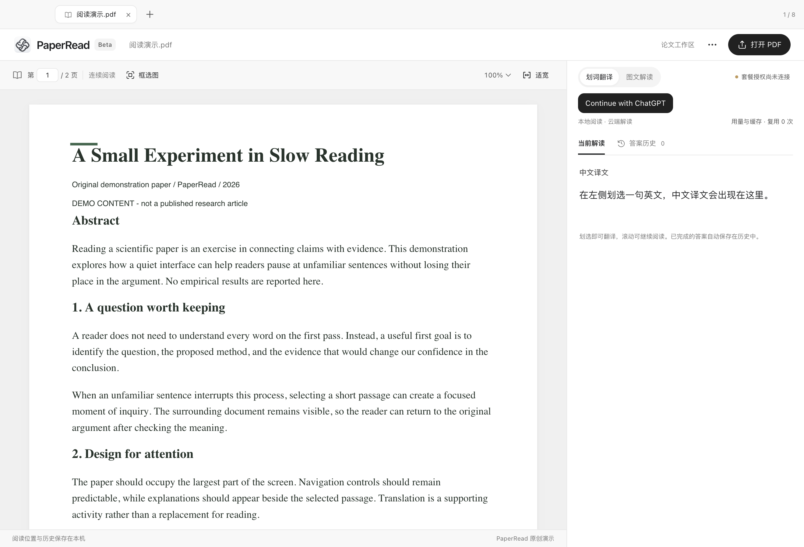

<h1 align="left"> CISRead</h1>

[简体中文](README.md) · English

**CISRead** is a macOS reader for English research papers. Read the original continuously, select a passage for a Chinese translation, and interpret figures with supporting text.

**Initial Beta release: CISRead Beta 1 · `1.0.0-beta.1`**

For **macOS 13+ on Apple Silicon**.

[Download Beta 1](https://github.com/YouthLiuYS/CISRead-Beta/releases/tag/v1.0.0-beta.1) · [Installation guide](BETA_GUIDE.md) · [Report an issue](https://github.com/YouthLiuYS/CISRead-Beta/issues/new?template=bug_report.yml) · [Privacy](PRIVACY.md)

## Features

- **Paper-aware translation:** the first translation builds a reusable context card from extracted paper text in segments. Later translations use the paper's topic, terminology, definitions, and relevant original passages to preserve the selected passage's meaning.
- **Context and terminology:** inspect the context card and source-page references, and correct Chinese terminology for that paper.
- **Per-paper caching:** exact repeated requests reuse completed local answers when the paper, selection, context, model, and reasoning effort match. Different papers do not share translations.
- **Figure interpretation:** capture a figure, attach its caption and related text, and ask for a Chinese explanation.
- **Continuous reading:** scroll through all pages and keep up to eight papers in tabs in one window.
- **Local continuity:** restore saved PDFs, reading positions, figure drafts, and completed answer history.
- **Model controls:** choose an available model and its supported reasoning effort.
- **Desktop styling:** follow the system's light or dark appearance with a white-and-graphite application icon.

The interface currently uses Chinese labels and translates into Chinese. This English README does not imply an English interface.

## Install and try it

1. Download either ZIP or DMG from the Beta 1 Release; you only need one format.
2. Extract the ZIP or open the DMG, then copy **`CISRead.app`** to **Applications**. Quit an existing instance before replacing it.
3. Launch CISRead and select **Continue with ChatGPT**. Sign in to your own eligible account in the system browser and authorize plan usage. OpenAI determines eligibility, model access, limits, and service availability.
4. Open an English PDF with a text layer and select a complete sentence. The first context preparation may take longer and consume more plan usage; the resulting context and completed translations are reused locally.
5. For a figure, use figure mode, capture the relevant area, add supporting text, and explicitly start interpretation.

No separate API key, local language model, Node installation, or independently running server is needed for the packaged app. Reading remains available when the plan is disconnected. Each tester uses their own plan; no developer account, credentials, or shared quota are distributed. There is no automatic updater.

The Beta uses an **ad-hoc integrity signature**, not Apple Developer ID signing or notarization. If you trust the source, follow [Apple's app-specific opening instructions](https://support.apple.com/102445) and verify the Release's `SHA256SUMS`. Do not disable system protection. Managed devices may not allow an exception.

## Paper context, usage, and privacy

PDF rendering and text extraction happen locally. The first context request sends extracted paper text to OpenAI in segments; later translations send the selected passage with necessary context. Figure interpretation sends the image and text you explicitly include. Context preparation and higher reasoning effort consume plan usage.

Viewing history, opening a context card, and correcting terminology do not themselves run inference. Completed local cache hits are identified in the interface. Local request and cache statistics are not a live subscription balance; use the app's link to the official usage page.

The app manages its own authorization, without reading Codex login files. Credentials remain encrypted in the user's local application data. There is no automatic telemetry, crash upload, or feedback submission. See [privacy details](PRIVACY.md) and the [official local-tool documentation](https://developers.openai.com/cookbook/articles/sign-in-with-chatgpt).

## Limits and feedback

Only Apple Silicon macOS has been validated. No Windows, Linux, or Intel Mac installer is provided. There is no OCR text layer for scanned pages, although selected images can be discussed. Full-paper indexing is limited to 2,000 pages, 600,000 text characters, and 6,000 passages; missing text coverage is disclosed rather than treated as understood content.

Model output can be wrong, particularly for equations, measurements, terminology, and chart conclusions. Check the original evidence. In [GitHub Issues](https://github.com/YouthLiuYS/CISRead-Beta/issues/new?template=bug_report.yml), include the app version, macOS version and chip, steps, expected behavior, and actual behavior. Do not publish private papers, credentials, or sensitive screenshots.

This is a free, personal, noncommercial Beta. The bundled Sign in with ChatGPT runtime has its own [noncommercial license](licenses/SIWC-LICENSE.txt). CISRead is an independent project, not an official OpenAI or Anthropic product.

## Release baseline

**Beta 1 starts the CISRead Beta program.** Future Betas build on this baseline. The public repository provides CISRead installers and documentation.

This repository contains distribution materials and feedback templates, without private source history, developer credentials, or personal papers.

[Release notes](RELEASE_NOTES.md) · [中文说明](README.md)
