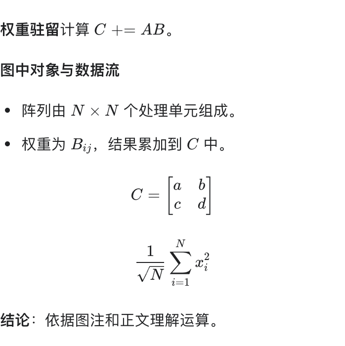

<h1 align="left"> CISRead</h1>

简体中文 · [English](README.en.md)

**CISRead** 是用于英文论文精读的 macOS 桌面软件：连续阅读原文、划选查看中文翻译，并结合论文语境和图文证据理解内容。

**当前版本：CISRead Beta 4 · 1.0.0-beta.4**

适用 **macOS 13+ / Apple Silicon（M 系列 Mac）**。

[下载 Beta 4](https://github.com/YouthLiuYS/CISRead-Beta/releases/tag/v1.0.0-beta.4) · [安装与使用](BETA_GUIDE.md) · [反馈问题](https://github.com/YouthLiuYS/CISRead-Beta/issues/new?template=bug_report.yml) · [隐私说明](PRIVACY.md)

## 可以试用什么

- **论文语境翻译**：首次翻译时分段整理提取的全文，生成可复用语境卡；翻译结合主题、专业术语、定义及相关正文，保留选句在论文中的含义。
- **语境卡与术语修正**：查看概括、原文依据与页码；为本篇论文修正中文术语译法，后续翻译优先采用。
- **按论文区分的缓存**：同一论文、选区、语境、模型及思考深度的重复请求复用本机答案，显示“本机缓存 · 未调用云端”；不同论文不会混用答案。
- **应用内更新**：检查新版本后直接下载、查看进度、校验签名，点击“重启并安装”完成升级；先保存全部论文标签和记录，不消耗翻译套餐用量。
- **公式排版**：译文和图文解释中的分式、根号、上下标、求和与矩阵直接以公式显示；已有缓存和历史无需重新调用模型即可获得同样排版。
- **图文解读**：框选论文图，添加图注、相关正文和问题，获得中文解释。
- **连续阅读与多标签**：所有页面上下滚动；同一窗口最多同时保留 8 篇论文。
- **阅读恢复与历史**：本机保存论文副本、阅读位置、图文草稿及已完成答案，重启后恢复。
- **模型与思考深度**：选择本人账号可用的模型及其支持的推理档位。
- **简洁桌面界面**：跟随系统深浅色，保留白底石墨灰材质图标。

当前界面和翻译输出为中文；英文 README 提供使用说明，不代表应用已有英文界面。

公式排版示例（本地演示文本）：

## 参加内测

1. 下载 Release 中的 ZIP 或 DMG，只需一种，将 `CISRead.app` 放入“应用程序”。
2. 点击 **Continue with ChatGPT**，在系统浏览器登录你自己的符合资格账号，并授权套餐使用。实际可用性、模型和额度由 OpenAI 决定；未连接也可阅读 PDF。
3. 打开有文字层的英文论文，划选完整句子。首次整理论文语境会分段发送提取的全文，可能需要更长时间并消耗套餐用量，随后复用语境和缓存。
4. 通过应用内“反馈问题”报告复现步骤及不含隐私的截图。

内测免费，云端推理使用测试者本人的套餐；不提供共享账号、额度或作者的登录资料。无需额外 API key、本地大模型、Node 安装或单独启动常驻服务。Beta 4 起可在应用内下载并重启安装更新，保留登录和本机阅读资料。Beta 1–3 请先安装一次 Beta 4。

## 数据与当前限制

PDF 渲染和文字提取在本机完成。首次语境整理发送提取的全文；之后发送选句及必要语境，图文解读发送你主动附加的资料。只有你发起翻译或解读才运行模型；查看历史、打开语境卡和修改术语不调用模型。详见 [隐私说明](PRIVACY.md)。

- 仅提供已验证的 Apple Silicon macOS 版本；Windows、Linux 和 Intel Mac 暂未验证。
- Beta 使用 ad-hoc 完整性签名，**没有 Apple Developer ID 签名和公证**；首次打开请参考[安装说明](BETA_GUIDE.md)，沿用系统安全确认流程。
- 扫描 PDF 暂无 OCR 文字层，可框选图片解读；无文字页会标明覆盖范围。
- 全文语境上限为 2000 页、60 万字符、6000 个文本片段，超限会明确提示。
- 用量面板显示本机调用和缓存统计，无法实时读取订阅余额。
- 模型可能误解术语、公式、数值或图表结论，请核对原文证据。

本阶段用于个人学习、研究和非商业体验。所含 Sign in with ChatGPT 运行库及修改受[独立非商业许可](licenses/SIWC-LICENSE.txt)约束。CISRead 是独立项目，并非 OpenAI 或 Anthropic 的官方产品。

## 版本与反馈

**Beta 1 是 CISRead 内测的起点。** 后续内测以此为基线迭代，公开仓库仅保留 CISRead 的安装包与说明。

[发布说明](RELEASE_NOTES.md) · [提交反馈](https://github.com/YouthLiuYS/CISRead-Beta/issues/new?template=bug_report.yml) · [OpenAI 本地工具接入说明](https://developers.openai.com/cookbook/articles/sign-in-with-chatgpt)

此仓库只提供分发资料、安装包和反馈入口；私有源码、账号凭据和个人论文不在其中。
